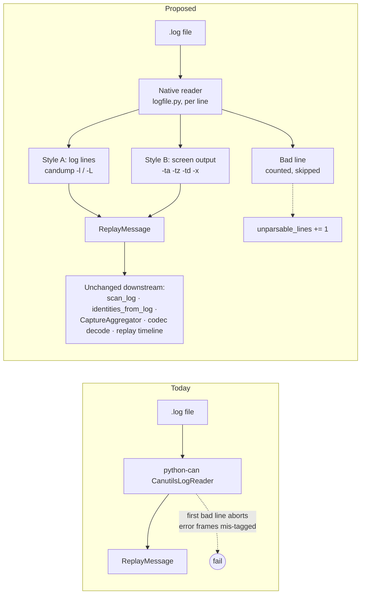

# candump Log Support Proposal

2026-10-28

**Status:** Style A (`candump -l`/`-L`) is implemented as a native `CandumpLogReader`
in `logfile.py`. Style B (screen output) is deferred: timestamped screen output
counts as unparsable, so a file of it fails with "no readable frames".

The CAN bus monitor already replays `candump -l` `.log` files through python-can,
but that path fails on common real-world logs. This proposal replaces it with a
native reader in `logfile.py` that skips bad lines, keeps error frames correct,
and also reads candump's screen output.

## Current gaps

Four defects were reproduced against `CandumpLogReader`
(`iotsploit-protocols/src/iotsploit_protocols/canbus/logfile.py:653`), which
delegates to python-can's `CanutilsLogReader`.

| # | Problem | Probe input | Observed result |
| --- | --- | --- | --- |
| 1 | One bad line aborts the whole replay. ASC skips and counts bad lines; candump does not. The usual cause is the cut-off last line after Ctrl-C. | `(…000100) can0 123#1122` then `(…0002` | `CanLogError: not enough values to unpack` |
| 2 | Non-bus error frames become data frames. python-can only flags an error when bit `0x80` is set. | `20000004#0004000000000000` | ID `0x4`, extended, `is_error_frame=False` |
| 3 | Bus-error frames lose their channel and appear as a fake channel `0`. | `20000088#…` with `channel="can0"` | `error_frames: 0`, `channels_present: [0, 'can0']` |
| 4 | Only the `-l`/`-L` style is read. Saved screen output (`candump -ta can0 \| tee cap.log`) fails. | `  can0  123   [8]  11 22 33 44 55 66 77 88` | `too many values to unpack` |

In every case `unparsable_lines` reports 0, so the stats never show a partial read.

## Proposal

Replace the python-can wrapper with a native candump parser in `logfile.py`,
built like `AscLogReader`: same `ReplayMessage` output, same `LogReadStats`, and
a bad line is counted and skipped, never fatal. One reader handles both candump
styles and decides per line which one it is.

**Style A: `candump -l` / `-L` log lines**

- `(ts) iface ID#hex`, with an optional trailing `T`/`R`
- `ID##<flags>hex` for CAN FD; the payload length must be a valid FD length (12, 16 … 64)
- `ID#R` and `ID#R<len>` for remote frames
- Any ID with the error flag `0x20000000` becomes an error frame and keeps its
  channel, so `errorframes.py` classifies it as in live capture (fixes gaps 2 and 3)
- An odd hex length, an out-of-range ID, or a CAN XL `###` line counts as unparsable

**Style B: candump screen output (timestamp required)**

- `(ts) iface ID [len] bytes…` from `-ta` or `-tz`; `-td` deltas are summed into running timestamps
- `-x` extras (`TX - -`, `RX B E`), `remote request`, two-digit FD lengths `[64]`, and the `-a` text column `'…'`
- Output without timestamps (plain `candump can0`) is rejected with
  "recapture with `candump -l` or `-ta`", because replay needs a timeline

**Unchanged**

- The reader is still chosen by the `.log` suffix, never by sniffing content, so
  the accepted-formats list in the UI and CLI stays the same.
- `channels_present`, `--log-channel can0`, `scan_log`, `identities_from_log`
  and the replay timeline work unchanged on top.

## Pipeline

Each line is routed to Style A, Style B, or counted as bad; only the reader
changes, everything after `ReplayMessage` stays as it is.

## Scope and tests

The core change is about 120–150 new lines in `logfile.py` and 2 removed (the
`CandumpLogReader` subclass). No new files.

- Extend `iotsploit-protocols/tests/test_canbus_logfile.py` with the four failing
  probes above, plus `-ta`, `-td` and `-x` samples.
- The existing round-trip test against python-can's `CanutilsLogWriter` keeps
  guarding the `-L` style.

**Optional follow-ups (separate changes)**

- Accept `.txt`: a one-line suffix mapping for saved screen captures, but `.txt`
  is a generic extension. Recommended only if captures are often saved that way.
- Save to candump: the live monitor cannot record a session today. Writing a
  `candump -L` file from `live_capture.py` would let a capture be replayed later
  with the same decoding.

**Open questions**

- [ ] Include the `.txt` suffix in the core change?
- [ ] Schedule save-to-candump as the next change?
